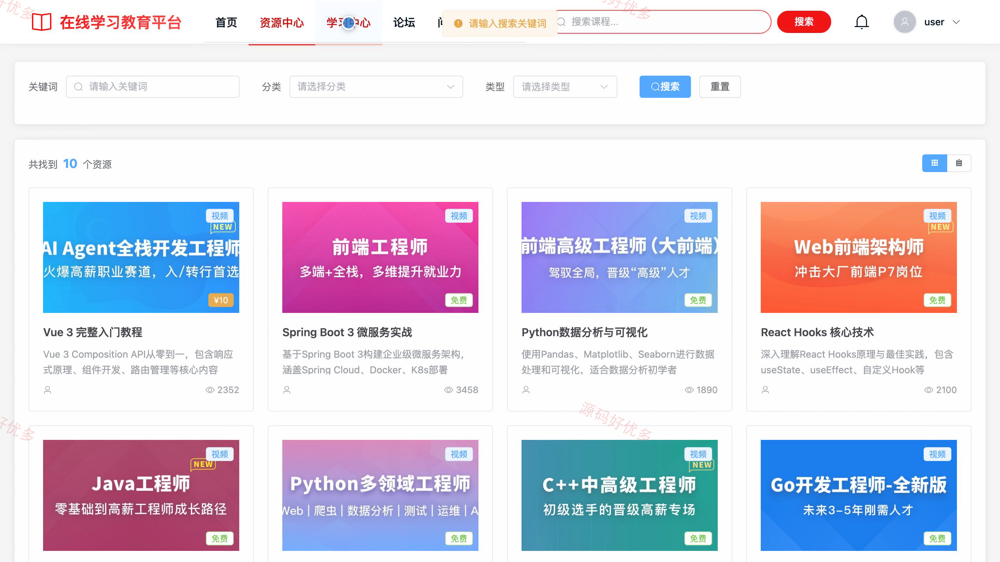
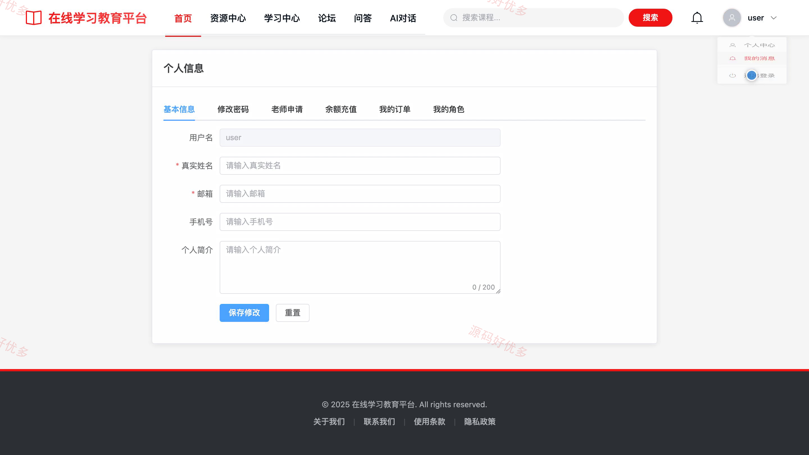
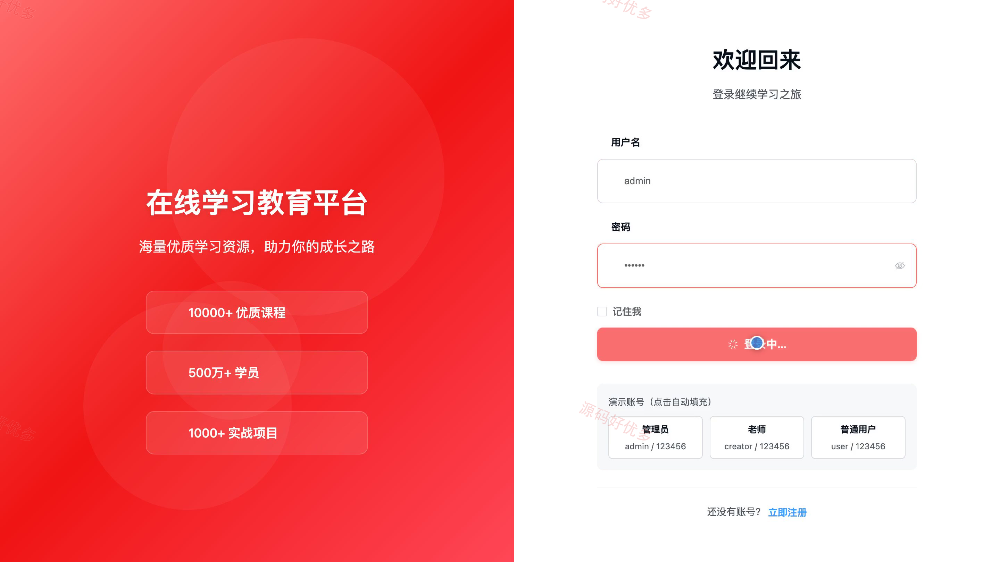
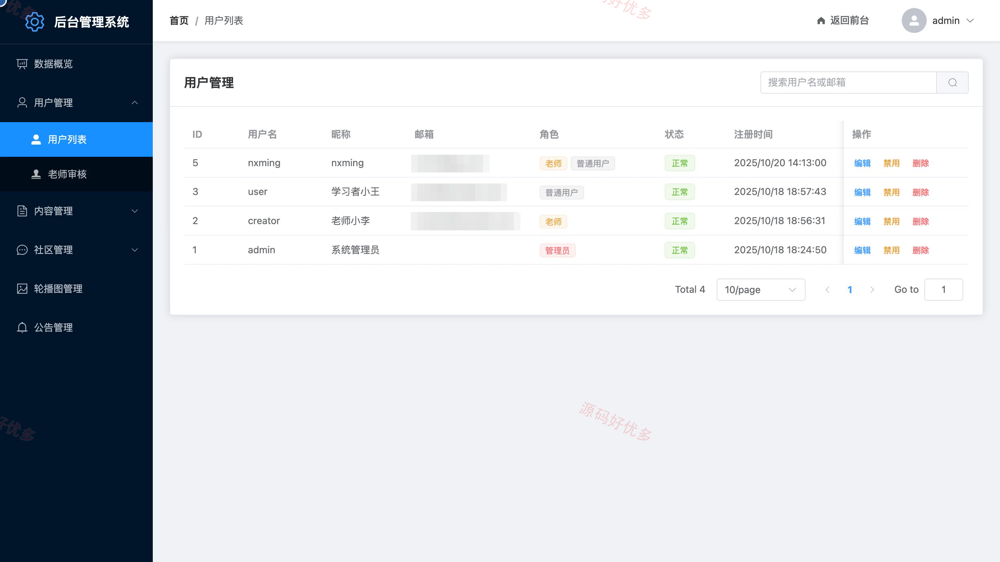
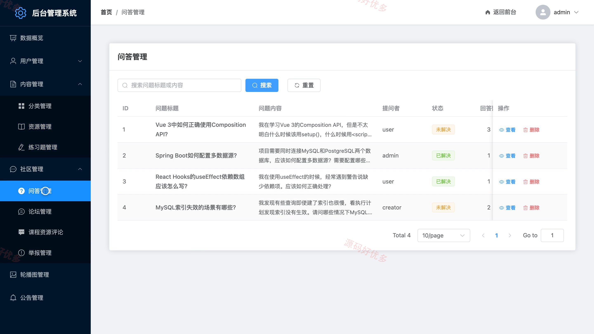
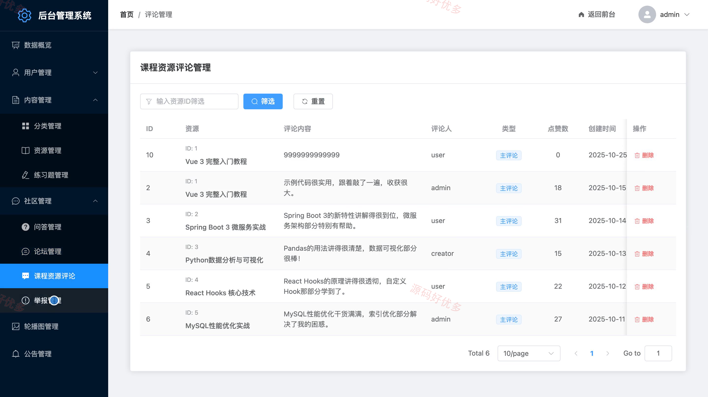
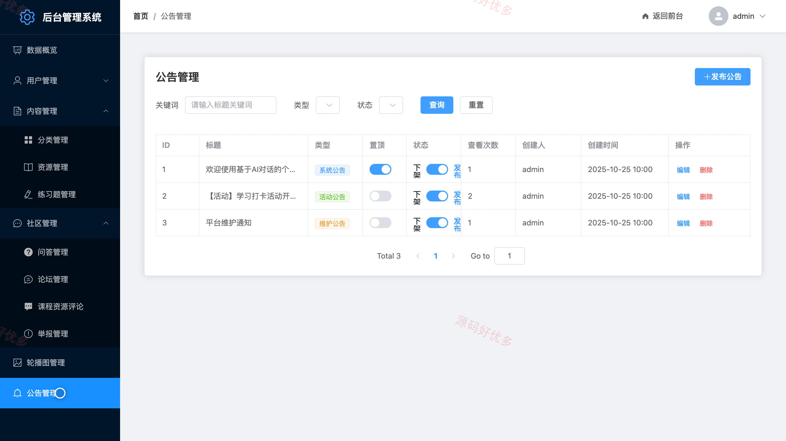

## 源码问题查看主页咨询

### 一、关键词
在线学习、网络课程、教学资源共享、学习进度管理、课程问答

### 二、作品包含
源码+数据库+万字设计文档+PPT+全套环境和工具资源+本地部署教程

### 三、项目技术
前端技术： Html、Css、Js、Vue3.4、Element-Plus
后端技术：Java、SpringBoot3.1.5、MyBatis-Plus

### 四、运行环境要求
开发工具：IDEA/eclipse + VSCODE

数据库：MySQL5.7+（共28张表）

数据库管理工具：Navicat10以上版本

环境配置软件： JDK17 + Maven3.6

前端Nodejs：18.0.0+

浏览器：谷歌浏览器

### 五、项目介绍
项目编号：bs126A

面向普通用户、老师和管理员的在线学习平台，支持课程资源浏览与学习、进度记录、互动交流、老师上传资源，以及后台资源审核和用户管理。

角色：普通用户、老师、管理员

普通用户功能：课程资源浏览与检索、视频和文档学习及进度记录、资源收藏与练习题、评论互动、课程问答与论坛交流、付费资源购买与余额充值、个人资料和消息管理、学习辅助对话。

老师功能：课程资源上传、个人资源管理、练习题维护、资源学习数据查看、视频和文档学习、课程问答与论坛交流、资源收藏与评论、个人资料和消息管理。

管理员功能：学习数据概览、用户与老师审核管理、资源与分类管理、练习题管理、问答论坛及评论管理、轮播图与公告管理、举报处理、资源审核。

### 六、运行截图

